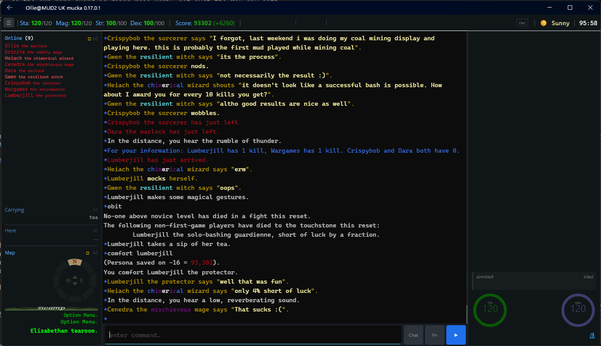
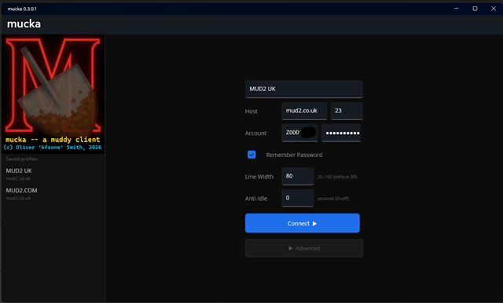
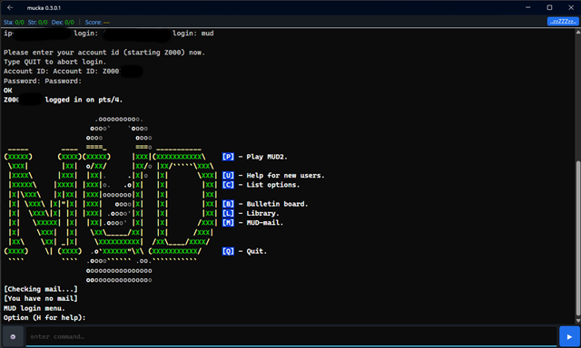
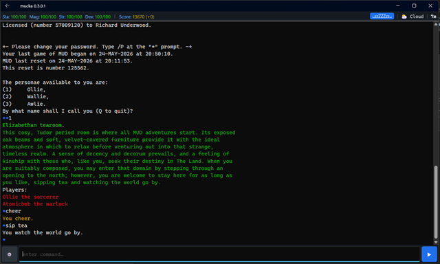
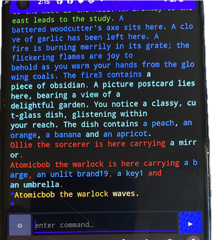
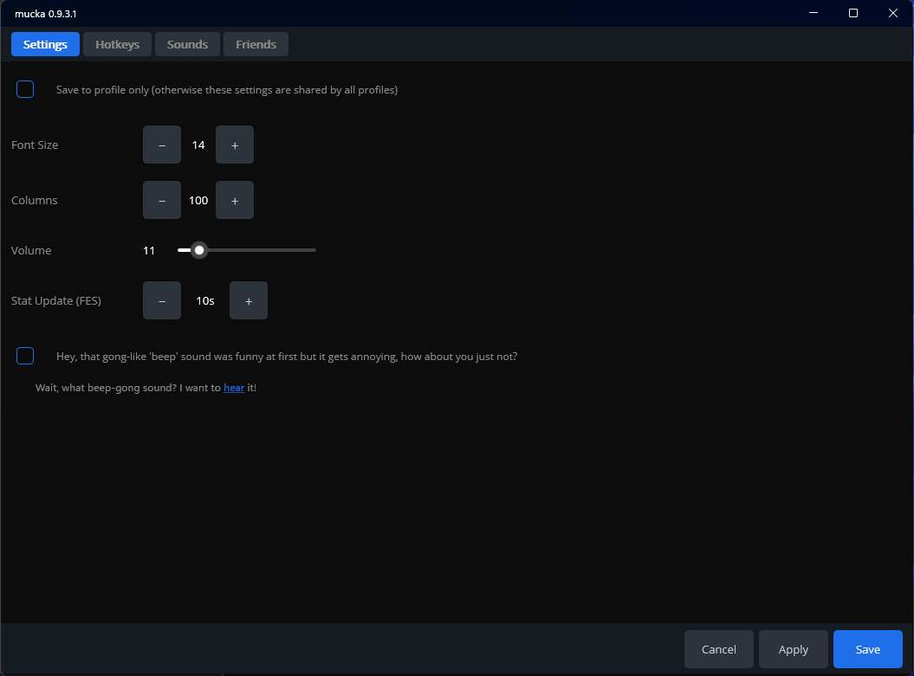
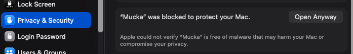

Mucka -- A dedicated MUD2 client for Windows, Android and MacOS
===============================================================

<table>
<tr>
<td></td>
<td>

- [Screenshots](#screenshots)
- [Install: Windows](#install-windows)
- [Install: Mac](#install-mac)
- [Install: Android](#install-android)

</td>
</tr>
</table>

Mucka is heavily inspired by Ian Peattie's "Clio".

- Automatic Login,
- MUD2 client mode,
- Sounds,
- Hotkeys (F1-F12),
- Dreamword capture & hotkey/tap,
- Status bar with Sta/Mag/Str/Dex, Weather, Time to Reset, Debuffs,
- Side Panel with player list, inventory, items, and compass,
- Combat side panel showing what you've fought, what you're fighting,
- Score graphing,

---

MUD is Copyright (C) 1991-2026 [Multi-User Entertainment Ltd](https://mud.co.uk/muse/).

See also: [MUDII.co.uk](https://mudii.co.uk/), [MUD2.com](https://www.mud2.com/),
and [British Legends (MUD1)](https://www.british-legends.com/).

Clio is Copyright (C) Ian Peattie 2023.  https://www.wabe.org.uk/clio/

mucka is Copyright (C) Oliver 'kfsone' Smith, 2026. https://github.com/kfsone/mucka/

## Screenshots

---

## Installing

Download from the [latest release](https://github.com/kfsone/mucka/releases/latest), under
"Assets". Pick the file for your device:

### Install: Windows

- `mucka-windows-...-setup.exe` - the installer. Run it and you are done.
- `mucka-windows-...zip` - a portable copy with no installer, for people who know where they want
  it. Unzip it anywhere and run it from there.

### Install: Mac

- `mucka-macos-...zip` - double-click it to unpack, then drag `Mucka` to Applications (or
  anywhere else).

Mucka is not signed with an Apple developer account, so the first time you open it macOS says it
cannot verify it is free of malware. That is expected. Open **System Settings > Privacy &
Security**, scroll down to "Mucka was blocked to protect your Mac", and press **Open Anyway**. You
only do this once.

### Install: Android

- `mucka-android-...apk` - open it on your phone to install. Android will ask you to allow
  installing apps from your browser or files app the first time.
